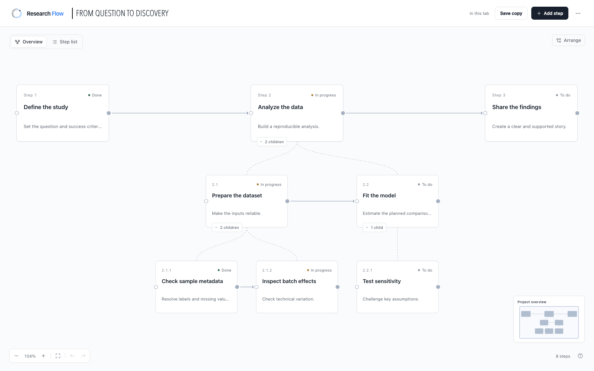

# Research Flow

**A clear view of your research, from action to completion.**

Research Flow is a visual planner for a single research project. Connect steps,
organize them into branches, and keep your workflow in a readable YAML file on your
own machine or Linux server.



## Features

- **Dependency stages** — group steps automatically from left to right, with independent steps together; switch to freeform to use your saved arrangement.
- **Canvas editing** — arrange, connect, rename, and delete steps directly on the canvas.
- **Nested branches** — organize numbered steps and children, with an indented list view.
- **Focus and overview** — zoom into a branch or navigate the whole project with the minimap.
- **Details in one place** — track each step's status, goals, notes, inputs, and outputs.
- **Undo and redo** — revisit changes as your plan evolves.
- **Your files, your workflow** — save to YAML with previous-version backups and protection against conflicting edits.
- **Interactive preview beside your workflow** — each Save refreshes a standalone, read-only HTML viewer, ready to explore without launching the app.

## Quick start

Requires **Python 3.10+** and [pipx](https://pipx.pypa.io/stable/installation/).

```bash
pipx install https://github.com/SpicyChicken6/research-flow/releases/download/v0.8.7/research_flow-0.8.7-py3-none-any.whl
pipx ensurepath
```

Reopen your terminal if needed, then launch from your research folder:

```bash
cd ~/research/my-study
research-flow
```

Open the private URL printed in the terminal. Keep the app running and click
**Save** to write your changes to the selected YAML file.

Saving `workflow.yaml` also creates or updates `workflow.html` in the same folder
on the machine running Research Flow. Open that file in a browser to zoom, pan,
expand branches, switch Stages / Freeform layouts, and read task details without
running the app. The viewer includes all branches, starts in the saved layout mode,
and embeds its data and assets for offline use. It shows the last saved snapshot;
reload an open viewer after saving again. Opening a workflow does not write a preview.

To edit, run `research-flow` and open its private URL. The saved HTML stays read-only,
even while the app is running. Use **More → Export SVG** in the running app when you
need a figure for Markdown, documents, or slides. Existing SVG files are left intact
and are no longer refreshed automatically.

If the preview cannot be written, your YAML still saves: the app shows
**Saved · preview unavailable** and lets you retry with **Save**. An existing HTML
that was not generated for this workflow is preserved; move it aside before retrying.
Older editable portable exports still support **Save copy**. Automatically saved
HTML previews are read-only and never write to your YAML.

- **One YAML/YML file in the folder:** opens it.
- **No YAML files:** asks before creating `workflow.yaml` (default: Yes).
- **Several YAML files:** choose one with `research-flow --project ./my-study.yaml`.

Existing files must be valid Research Flow workflows.

To update to the latest repository code, save and stop the app, then run
`research-flow --update` and launch it again. See the
[update guide](docs/install.md#update-or-uninstall) if your installed version does
not yet have this option.

### Working on a remote server?

In VS Code Remote-SSH, enable [integrated browser remote access](docs/install.md#open-inside-vs-code-over-remote-ssh),
then open the printed URL with **Browser: Open Integrated Browser**. No manual port
forwarding is needed with this setup. Your changes save to the YAML on the server.

See the [installation and VS Code guide](docs/install.md) for setup and upgrades,
or the [Linux guide](docs/linux.md) for persistent services and troubleshooting.

[Download releases](https://github.com/SpicyChicken6/research-flow/releases) · [Security and privacy](SECURITY.md)
